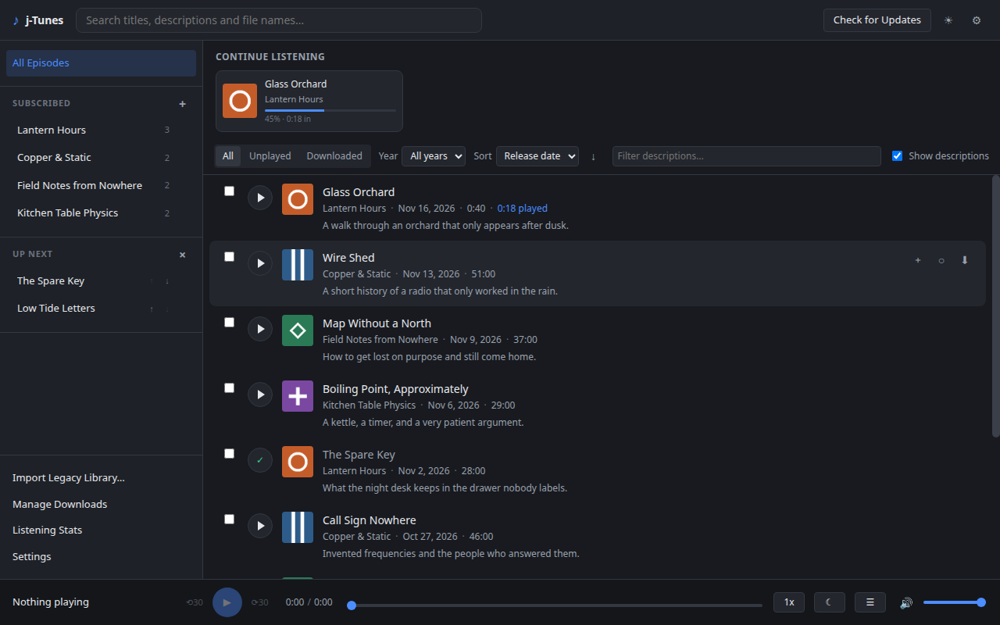

# j-Tunes

[](https://github.com/Reveille33/j-tunes/actions/workflows/ci.yml)
[](LICENSE)

A desktop podcast player for a large local library: subscribe, download, and listen without an account.



## Features

- Subscribe by RSS or Atom URL, or search the iTunes podcast directory.
- Play episodes from disk or from the feed, with speed control, skip, resume, sleep timer, and Podcast 2.0 chapters.
- Keep an Up Next queue that continues when an episode ends.
- Download episodes, including pause, resume from a partial file, retry, and cancel.
- Import an existing folder of audio files, and import or export subscriptions as OPML.
- Search titles, descriptions, and filenames with SQLite FTS5, and filter by podcast, year, and played state.
- Listening stats, a storage view of downloaded files, and dark and light themes.

## Download

Windows installers are published on [GitHub Releases](https://github.com/Reveille33/j-tunes/releases). The installer is unsigned, so Windows SmartScreen will warn before it runs.

A Mac build is unsigned. The first time you open it, Gatekeeper blocks it. Right-click the app and choose **Open**, or go to **System Settings > Privacy & Security** and choose **Open Anyway**.

## Build from source

```bash
npm ci
npm run dev          # hot-reload the app
npm test             # unit tests
npm run typecheck
```

A Windows installer has to be built on Windows (`better-sqlite3` is native, and packaging does not cross-compile it):

```bash
npm run build && npx electron-builder --win nsis --publish never
```

On a Mac, `npm run dist:mac` builds unsigned Apple silicon and Intel disk images and zips (`release/j-Tunes-<version>-arm64.dmg` and `release/j-Tunes-<version>-x64.dmg`, plus matching `.zip` files). Each package gets the `better-sqlite3` prebuild for that architecture. The first launch of an unsigned app is blocked by Gatekeeper: right-click the app and choose **Open**, or go to **System Settings > Privacy & Security** and choose **Open Anyway**.

`--publish never` writes the installer under `release/` and does not publish a release. `npm run screenshots` rebuilds the app and refreshes the PNGs in `docs/screenshots/` from invented demo data.

## Stack

Electron 45, React 19, TypeScript, and SQLite via `better-sqlite3`, bundled with electron-vite.

The original design notes are in [`docs/IMPLEMENTATION_PLAN.md`](docs/IMPLEMENTATION_PLAN.md).

## Licence

MIT
